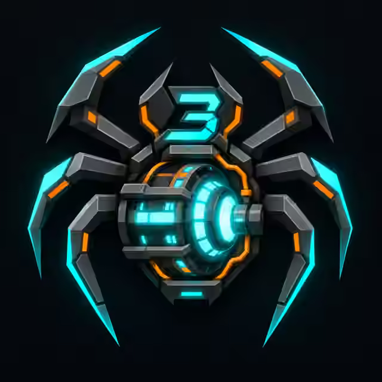

# spi3der



Interactive 3D creation and exploration, powered by **3Draft**. Based on the 2026 Fifth Percent competition sprint.

The editor opens with **no scene** and **does not request VR** until you choose Enter XR. WebXR/Meta Quest and ViRtuSH hand interactions remain available. The scene picker offers **Globe**, **Deep Sky** and **Fifth Percent VR (LARK + Deep Sky)**. Model-format tooling is retained.

## OpenAI plugin package manifest

The portable [plugin.json](plugin.json) defines the **spi3der** listing: display name, description, developer, existing PNG icons, and both `homepage` and `extensions.com.openai.interface.websiteURL` set to [Tüskék és Gyökerek](https://tuskek-es-gyokerek.vercel.app). The companion [mcp.json](mcp.json) declares the remote MCP endpoint used by the embedded workshop (`https://spi3der.cloud.run/mcp`).

These are packaging files only. They do **not** change the existing custom MCP connection or automatically publish the plugin. For a public directory submission, use the plugin submission flow **With MCP** and complete domain verification, tool checks, and review materials. The currently absent `privacyPolicyURL` and `termsOfServiceURL` must be added only after genuine public pages exist; do not use placeholders. The manifest's semantic version (`1.0.0`) is the **plugin package version**, independent of spi3der's date-based npm version.

## Native UI refinements (Nov 2026)

- The ChatGPT-embedded editor (`?workshop=1`) starts in spi3der's **existing Zen mode** (model full-screen), with the native **Leave zen** control, **Z**, or **Esc** to restore the full UI. Normal standalone spi3der starts with its full UI unchanged.
- The **SYS** panel now has an icon-only keyboard button for the **tutorial keycast**, ported from Spider Paint. When enabled, actual pressed keys and modifiers appear briefly at the top, without intercepting events or creating a second toolbar. Its enabled state is local to the browser (`spi3der.tutorial`). To enable it in a Zen-started workshop, exit Zen, activate the keyboard icon in SYS, then return to Zen with Z.
- **Save** is a disk icon; **Character builder** is a person emoji. Both retain their original actions, titles, and accessible names.
- `node tests/tutorial-ui.mjs` tests the native controls, Zen activation, and passive keycast; the MCP App CI workflow runs the test.

## ChatGPT-native collaborative MCP App Workshop

The primary workshop embeds the **real spi3der editor** inside a ChatGPT MCP Apps widget (resource `ui://spi3der/workshop-v7.html`). Its original controls, keys, selection, navigation, WebGL and XR remain authoritative: there is no second editor UI.

`open_workshop` creates a capability-scoped `session_id` and runs declarative modeling steps in the browser. The native editor publishes its scene after loading and after human geometry edits. The AI can then call `workshop_state({session_id})` to inspect the **actual** objects and revision, and `workshop_edit({session_id,revision,steps})` to enqueue further changes for **that same open workshop**. The widget polls for queued edits, models them in the browser through the 3Draft `WorkshopModel`, and imports the result into the native editor. The new scene is published back with a revision acknowledgement. A queued edit must not be mistaken for a completed edit; call `workshop_state` again to verify `last_edit.status === 'applied'`.

The older stateless `workshop_token` continuation and `#scene=` links still work. `workshop_edit` is the shared-workshop path and avoids generating a separate iframe for every agent change. A short integration guide, limits and detailed test procedure live in [WORKSHOP.md](WORKSHOP.md).

**MVP constraint:** session storage is **in memory** in the Cloud Run process (2-hour idle TTL, maximum 64 sessions). Keep Cloud Run at **one instance** for now; a cold restart, redeploy or different instance loses the session. This is not yet durable multi-user collaboration, and a server acknowledgement alone does not prove host-side rendering. Scenes are capped at 600 KB and edits use optimistic revisions to prevent stale writes. The `session_id` is a bearer capability: do not publish or log it.

Cloud Run serves the native browser app and the MCP bridge. WebGL and ordinary geometry execution remain browser-local. The earlier standalone `workshop.html` prototype is legacy diagnostics, not the product direction.

## Run locally

```sh
npm install
npm start
# or, after publishing to npm:
npx spi3der
```

Open http://localhost:5173. No application build system is needed.

## Project boundaries and deployments

- **spider-paint** (`Pengeszikra/Spider-Paint`) is the separate legacy project, deployed independently to Vercel and Cloud Run.
- **spi3der** (`Pengeszikra/spi3der`) is deployed to Cloud Run only, at `spi3der.run.app`, and has the `spi3der` npm package. There is no spi3der Vercel deployment.
- **3Draft** (`Pengeszikra/3Draft`) is the separate 3D engine repository and npm module.

The product name is always lowercase **spi3der**. The app header can retain **3Draft** as a quiet engine attribution.

## Cloud Run (browser app + MCP)

The Dockerfile now starts `bin/cloud-run.mjs` with Node.js on the Cloud Run `PORT`.
One origin serves the browser application, `POST /mcp` and the compatible `POST /api/mcp` endpoint.
It does **not** require a Vercel deployment. The legacy scene-store API is not hosted here.

```sh
# Deploy exactly the current Git commit and expose its SHA in the UI + MCP widget:
gcloud run deploy spi3der --source . --region europe-west1 --allow-unauthenticated \
  --update-env-vars "SPI3DER_GIT_SHA=$(git rev-parse HEAD)"
# Check the actual Cloud Run service URL; do not guess the hostname:
gcloud run services describe spi3der --region europe-west1 --format='value(status.url)'
```

Use the returned service URL plus `/mcp` as the ChatGPT custom MCP server URL.
Test locally with `PORT=8080 node bin/cloud-run.mjs` and `node tests/cloud-run.mjs`.
A GitHub push alone does not deploy Cloud Run unless the project has configured its own deployment trigger.

`GET /api/version`, the main editor's build stamp, the MCP tool result, and
the embedded ChatGPT workshop now show the spi3der package version followed by
the actual build's Git commit (shortened to 8 characters in UI). The full
hash is available in the JSON response and browser title/debug panel.
The multi-stage Dockerfile captures `git rev-parse HEAD` while the source checkout is present, stores it as a private `mcp/build-sha.txt`, then removes `.git` before producing the runtime image. A build from a source archive **without** `.git` must pass `--build-arg SPI3DER_GIT_SHA=<exact-source-commit>` to Docker, or set `SPI3DER_GIT_SHA` on the Cloud Run service (as in the command above). Never substitute the latest remote branch SHA: it might not match the deployed source. If the SHA truly is unavailable, the UI shows `git ?` instead of inventing an identity. Verify the deployed image at `GET /api/version` after redeploy.

## MCP debugging and timeout correlation

The `open_workshop` response returns a random `trace_id` in `structuredContent`
and in the textual tool result; the HTTP response also supplies `x-spi3der-trace-id`.
Use the MCP tool `debug_trace({trace_id})` to inspect a **recent** request.
Milestones include `request_received`, `steps_validated`, `response_ready`
and `request_failed`. Each event records elapsed milliseconds and response
size. **The MCP server does not know vertex/face counts:** those are determined
in the browser widget. No raw prompts, meshes, URLs or request bodies are logged.

The embedded widget optionally reports `widget_loaded`, `widget_rendered`,
`widget_empty`, or `widget_error` via `window.openai.callTool` when supported
by the host. **No widget feedback is not proof of a crash:** host sandboxes may
disallow callbacks, or rendering can time out before telemetry is delivered.
If the host times out before returning the response, inspect Cloud Run
structured logs for `component=spi3der-mcp` around the failure time instead.
Correlate using the `traceId` field (Cloud Run may have multiple instances).

Traces are deliberately metadata-only, kept **in memory for at most 15 minutes**
and limited to 128 per instance. `debug_trace` requires the unguessable trace ID;
there is no public endpoint listing other users' requests. For durable debugging,
use private Google Cloud Logging access. This cannot observe ChatGPT's internal
timeouts, only the stages that the server or widget actually reports.

To smoke-test locally:

```sh
npm run test:mcp-app
node tests/cloud-run.mjs
```

## npm

The package name is `spi3der`, with a CLI that hosts the app locally. The project uses its existing date-based `YY.M.DNNN` version scheme (`scripts/bump.mjs`) for npm releases as well.

```sh
npm run release -- --dry-run   # preview next date-based version, no changes
npm run release               # bump package.json, then npm publish
git add package.json
git commit -m "Release spi3der"
git push
```

Run `npm run release` instead of `npm publish`: direct publishing is guarded against accidentally reusing an existing version. The bump happens **before** npm constructs the tarball; npm's `prepublishOnly` hook runs too late to change the version npm has already chosen. Publication still requires your npm authentication and is not automatically triggered by a GitHub push. The project is licensed under MIT (see LICENSE).

## Compatibility

- `?scene=globe`, `?scene=deepsky` or `?scene=game:lark` explicitly loads a scene.
- `?autovr` explicitly enables the previous automatic headset VR offer.
- Desktop starts empty; use **Enter XR** to enter VR manually.

Original source: https://github.com/Pengeszikra/five-percent


## Legacy local Workshop 002 (diagnostics only)

```sh
npm install
npm run workshop
# open http://localhost:5173/workshop.html
```

This is a **local-first** shared scene with the existing 3Draft geometry kernel, not a second model format.

**Human in browser**: WebGL2 scene (drag to orbit, scroll to zoom, click to select), add/transform/rotate/remove named meshes, inspect deterministic SVG views, export JSON, and queue new instructions **while an agent is working**. The WebGL camera is *local to each browser*, not part of shared geometry.

**Agent in another terminal**: connect an MCP client to the same running Workshop instance through:

```json
{
  "mcpServers": {
    "spi3der-workshop": {
      "command": "node",
      "args": ["/ABSOLUTE/PATH/TO/spi3der/bin/workshop-mcp.mjs"]
    }
  }
}
```

This stdio proxy forwards all MCP calls into the **one** running HTTP workshop process. There is no second scene. On the same machine: `npm run mcp:workshop`. The proxy accepts `SPI3DER_WORKSHOP_URL` if the HTTP endpoint is not on port 5173.

The agent should invoke ordinary 3Draft tools (`add_box`, `transform`, `render`, `inspect`, `list`, etc.) and periodically call **`workshop_messages`** to read new human instructions; **`workshop_reply`** acknowledges/responds to them. The browser's instruction box can take additional messages immediately, without cancelling scene operations. These messages are **not** auto-executed by a model: the connected agent has to poll them explicitly.

HTTP interface:
- `GET /api/scene`: scene state with monotonic revision
- `POST /api/tool`: execute a 3Draft tool against that scene
- `GET /api/events`: SSE changes to the shared scene and instruction queue
- `GET /api/version`, `GET /api/inbox`, `POST /api/inbox`, `POST /api/presence`, `GET /api/participants`
- `POST /mcp`: minimal JSON-RPC over HTTP, **not a complete Streamable HTTP MCP** transport; use the stdio bridge for MCP clients.

**Test:** `npm run test:workshop` exercises MCP → scene → browser API, instruction acknowledgments, participant presence and static-file protection.

**Current boundaries:** one process / one in-memory shared scene, no persistence across restart; no realtime editing link to the legacy full Spider Paint WebGL editor; no multi-user permission or concurrent edit locks; no agent background execution, no pause/resume coordinator; the HTTP MCP endpoint is a local prototype and is not authenticated. Only bind to 127.0.0.1. A host ChatGPT UI may not support embedding this external live viewer. No npm publish is implied by a Git commit.

Architecture and collaboration invariants live in `AGENTS.md`.
